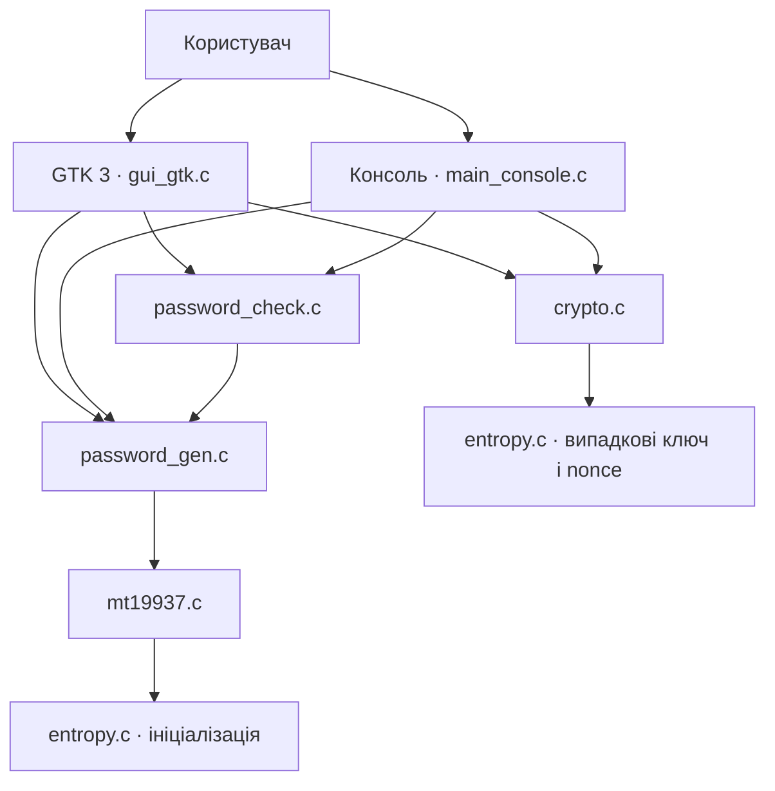
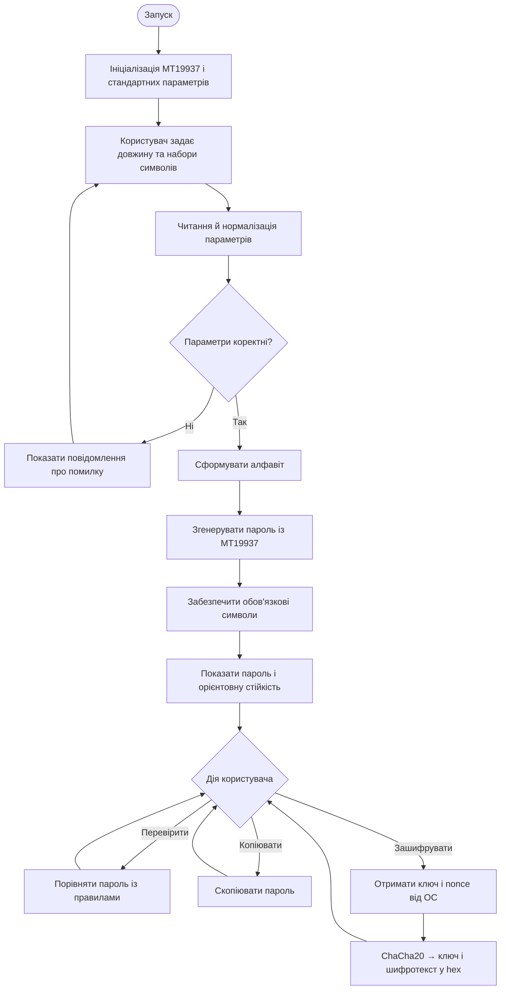
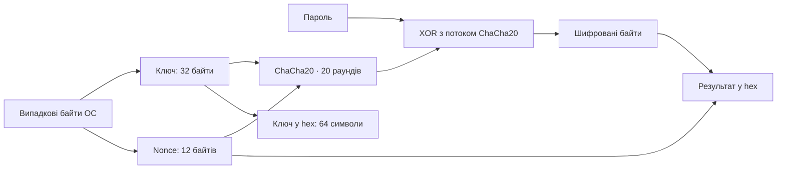

# Password Generator — технічна документація

**Навчальний проєкт мовою C**  
**Авторки:** Костик Крістіна, Синявська Дар’я (АВІС-2)  
**Репозиторій:** [dariasyniavska/password-generator](https://github.com/dariasyniavska/password-generator)  
**Документація:** `docs/documentation.md`

> **Коротко.** Password Generator — настільний застосунок для генерації паролів за заданими правилами, перевірки їхньої відповідності цим правилам, оцінювання орієнтовної стійкості та шифрування за допомогою ChaCha20. Реалізовано графічний інтерфейс на GTK 3 і консольний режим. Генерація паролів використовує MT19937; ключі шифрування отримуються **безпосередньо від операційної системи**.

## Зміст

1. [Опис проєкту та призначення](#1-опис-проєкту-та-призначення)
2. [Функціональні можливості](#2-функціональні-можливості)
3. [Структура й архітектура](#3-структура-й-архітектура)
4. [Алгоритм роботи програми](#4-алгоритм-роботи-програми)
5. [Генерація паролів і MT19937](#5-генерація-паролів-і-mt19937)
6. [Перевірка та оцінювання стійкості](#6-перевірка-та-оцінювання-стійкості)
7. [Шифрування ChaCha20](#7-шифрування-chacha20)
8. [Інтерфейси та робота користувача](#8-інтерфейси-та-робота-користувача)
9. [Збірка й запуск](#9-збірка-й-запуск)
10. [Тестування](#10-тестування)
11. [Обмеження та питання безпеки](#11-обмеження-та-питання-безпеки)
12. [Ключові рішення в реалізації](#12-ключові-рішення-в-реалізації)
13. [Висновки та подальший розвиток](#13-висновки-та-подальший-розвиток)

---

## 1. Опис проєкту та призначення

**Мета:** реалізувати генератор паролів із налаштуванням допустимих і обов'язкових символів, перевіркою результату та окремим механізмом шифрування.

**Проблема:** під час створення паролів вручну користувачі часто повторюють знайомі комбінації або не дотримуються конкретних вимог до складу пароля. Застосунок допомагає формувати рядки за визначеними правилами й виявляти некоректні налаштування.

**Цільова аудиторія:** студенти, розробники, тестувальники та користувачі, яким потрібні паролі із заданою довжиною і набором символів. Проєкт також має навчальне призначення: демонструє роботу з псевдовипадковими числами, шифруванням, перевіркою вводу й GUI мовою C.

**Технології:** C (GNU11), GTK 3, `make`, `pkg-config`, математична бібліотека `libm`, платформні джерела випадкових байтів. Застосунок працює локально; мережевий сервер або база даних у проєкті не використовуються.

## 2. Функціональні можливості

| Можливість | Реалізація |
| :--- | :--- |
| Генерація паролів | Довжина від 4 до 128 символів, вибір категорій і спецсимволів |
| Обов'язкові символи | Вимога наявності малої/великої літери, цифри та конкретних спецсимволів |
| Перевірка пароля | Контроль довжини, дозволеного алфавіту та виконання обов'язкових вимог |
| Оцінювання стійкості | Орієнтовна кількість бітів і п'ять категорій за порогами |
| Шифрування | ChaCha20 із новими випадковими 256-бітним ключем та 96-бітним nonce |
| Графічний інтерфейс | GTK 3: налаштування, генерація, перевірка, копіювання, шифрування |
| Зручність і керування даними | Показ/приховування пароля й ключа, копіювання ключа/шифротексту, очищення результатів |
| Консольний режим | Послідовне введення параметрів і виведення результатів у терміналі |
| Автоматизовані тести | MT19937, генератор, перевірка паролів, шифрування |

## 3. Структура й архітектура

Проєкт поділено на **ядро**, **користувацькі інтерфейси** та **тести**. Графічна й консольна версії використовують ті самі функції ядра — алгоритми не дублюються.

```text
password-generator/
├── Makefile
├── README.md
├── docs/
│   └── documentation.md
├── include/
│   ├── mt19937.h
│   ├── entropy.h
│   ├── password_gen.h
│   ├── password_check.h
│   └── crypto.h
├── src/
│   ├── mt19937.c
│   ├── entropy.c
│   ├── password_gen.c
│   ├── password_check.c
│   ├── crypto.c
│   ├── gui_gtk.c
│   └── main_console.c
└── tests/
    ├── test_mt19937.c
    ├── test_generator.c
    ├── test_checker.c
    ├── test_crypto.c
    └── test_util.h
```

> Папка `docs/` додається разом із цим документом. Виконувані файли створюються під час локальної збірки.

### Схема взаємодії модулів



| Модуль | Відповідальність | Основні функції |
| :--- | :--- | :--- |
| [`mt19937.c`](../src/mt19937.c) | Псевдовипадкова послідовність | `mt_seed_array()`, `mt_next_u32()`, `mt_next_double()` |
| [`entropy.c`](../src/entropy.c) | Отримання випадкових байтів від ОС | `os_random_bytes()`, `mt_seed_from_os()` |
| [`password_gen.c`](../src/password_gen.c) | Правила, алфавіт і генерація | `normalize_settings()`, `build_alphabet()`, `generate_password()` |
| [`password_check.c`](../src/password_check.c) | Перевірка й оцінка стійкості | `check_password()`, `estimate_entropy_bits()`, `strength_level()` |
| [`crypto.c`](../src/crypto.c) | Шифрування та допоміжне hex-кодування | `encrypt_password()`, `decrypt_password()`, `chacha20_xor()` |
| [`gui_gtk.c`](../src/gui_gtk.c) | Графічний інтерфейс | Обробники кнопок, GTK-віджети, статуси |
| [`main_console.c`](../src/main_console.c) | Консольний сценарій | `main()`, опитування параметрів |

**Чому обрано модульну архітектуру:** алгоритми можна тестувати без запуску GTK, перевірка та шифрування доступні з обох інтерфейсів, а зміна зовнішнього вигляду не потребує переписування математичної частини.

## 4. Алгоритм роботи програми



Послідовність дій у GUI:

1. При запуску `mt_seed_from_os()` ініціалізує MT19937, а `settings_set_default()` заповнює стандартні налаштування.
2. Користувач обирає довжину, дозволені категорії символів і обов'язкові вимоги.
3. `read_settings_from_gui()` перевіряє введення, а `normalize_settings()` визначає, чи можливо згенерувати такий пароль.
4. `generate_password()` формує рядок, після чого `check_password()` контролює відповідність правилам.
5. GUI відображає пароль, оцінку стійкості та результат перевірки. За бажанням користувач копіює або шифрує пароль.

## 5. Генерація паролів і MT19937

### 5.1. Налаштування генерації

Структура `PasswordSettings` у [`include/password_gen.h`](../include/password_gen.h) містить довжину, прапорці дозволених і обов'язкових категорій та два набори спецсимволів.

| Параметр | Значення / правило |
| :--- | :--- |
| `length` | 4–128 символів; стандартно **16** |
| `allow_lower`, `allow_upper`, `allow_digit` | Дозвіл на малі літери, великі літери та цифри |
| `allowed_special` | Набір дозволених спецсимволів, до 64 символів |
| `mandatory_lower`, `mandatory_upper`, `mandatory_digit` | Вимога хоча б одного символу відповідного типу |
| `mandatory_special` | Конкретні спецсимволи, кожен з яких має бути присутній |

**Стандартно:** дозволені малі/великі латинські літери, цифри і `!@#$%^&*()+-_=`; хоча б по одній малій літері, великій літері й цифрі — обов'язкові.

### 5.2. Нормалізація параметрів

`normalize_settings()` перевіряє:

- діапазон довжини пароля;
- допустимість спецсимволів: друковані ASCII-знаки, без літер, цифр і пробілів;
- видалення повторів у списках спецсимволів;
- узгодженість прапорців: обов'язкова категорія автоматично стає дозволеною;
- **належність кожного обов'язкового спецсимволу до переліку дозволених**;
- існування хоча б одного дозволеного символу;
- чи не перевищує кількість обов'язкових позицій загальну довжину.

У разі помилки функція повертає відповідний `GenStatus`, і генерація не виконується.

**Приклад перевірки:** довжина `8`, обов'язкові спецсимволи `!@#$%^&*()` (10 унікальних знаків), усі вони також додані до дозволених. Результат: `GEN_ERR_TOO_MANY_MANDATORY`, оскільки 10 обов'язкових позицій не помістяться у 8-символьний пароль.

### 5.3. Як працює MT19937

**MT19937 (Mersenne Twister)** — детермінований генератор псевдовипадкових чисел із внутрішнім станом у **624 32-бітних словах**. У проєкті реалізовані ініціалізація стану, перетворення `twist` і формування чисел у `mt_next_u32()` та `mt_next_double()`.

```mermaid
flowchart LR
    OS[Випадкові байти ОС] --> SEED[8 слів по 32 біти]
    SEED --> INIT[mt_seed_array]
    INIT --> STATE[Стан MT19937: 624 слова]
    STATE --> TWIST[Twist + tempering]
    TWIST --> RAND[Число у діапазоні 0 ≤ x < 1]
    RAND --> INDEX[Індекс символу в алфавіті]
    INDEX --> PW[Черговий символ пароля]
```



**Ініціалізація:** `mt_seed_from_os()` намагається отримати 8 початкових 32-бітних слів через `os_random_bytes()`. У разі невдачі саме для ініціалізації MT19937 передбачений резервний варіант на основі `time()` і `clock()`; такий резерв менш надійний.

**Вибір символів:** `generate_password()` створює алфавіт із дозволених категорій і для кожної позиції обирає індекс на основі результату `mt_next_double()`.

**Обов'язкові символи:** `ensure_mandatory()` перевіряє, які вимоги вже виконано, а для решти обирає незайняті позиції та вставляє необхідні символи. Масив `locked[]` не дозволяє замінити вже зафіксований обов'язковий символ.

> **Важливе обмеження:** MT19937 **не є криптографічно стійким генератором**. Навіть початкове заповнення стану випадковими байтами ОС не робить усю подальшу послідовність криптографічно захищеною. Тому проєкт слід розглядати як навчальний застосунок; для генерації реальних секретів у продуктивній системі потрібно перейти на CSPRNG операційної системи.

## 6. Перевірка та оцінювання стійкості

### 6.1. Перевірка відповідності правилам

`check_password()` не просто шукає «складний» вигляд рядка, а перевіряє його **відповідність поточним налаштуванням**:

1. Чи коректні самі налаштування.
2. Чи дорівнює фактична довжина заданій.
3. Чи всі символи належать дозволеному алфавіту.
4. Чи присутні потрібні малі/великі літери та цифри.
5. Чи зустрічається кожен обов'язковий спецсимвол.

Повертається `CHECK_OK` або конкретна причина відмови: `CHECK_BAD_LENGTH`, `CHECK_BAD_CHAR`, `CHECK_MISSING_LOWER` тощо.

### 6.2. Формула оцінювання

Функція `estimate_entropy_bits()` використовує теоретичну формулу:

$$
H \approx L \cdot \log_2(N)
$$

де `L` — встановлена довжина пароля, а `N` — кількість унікальних символів у дозволеному алфавіті.

**Приклад:** для 16 символів і алфавіту із 62 літерно-цифрових знаків отримуємо приблизно `16 × log₂(62) ≈ 95,3 біта`.

### 6.3. П'ять рівнів стійкості

Ці пороги задані у функції `strength_level()` у [`src/password_check.c`](../src/password_check.c):

| Рівень | Оцінка | Діапазон, біт |
| :---: | :--- | :--- |
| 1 | Дуже слабкий | Менше 28 |
| 2 | Слабкий | Від 28 до менш ніж 36 |
| 3 | Середній | Від 36 до менш ніж 60 |
| 4 | Добрий | Від 60 до менш ніж 80 |
| 5 | Сильний | 80 і більше |

У GTK результат додатково відображається шкалою прогресу.

**Що означає оцінка:** це **орієнтир за вибраними параметрами**, а не виміряна криптографічна ентропія конкретного пароля. Формула припускає незалежний рівномірний вибір символів. Обов'язкові вимоги й алгоритм їхнього забезпечення можуть змінювати реальний розподіл; MT19937 також не забезпечує криптографічної непередбачуваності.

## 7. Шифрування ChaCha20

### 7.1. Призначення

Шифрування — **окрема функція**, яка перетворює готовий пароль на шифротекст. Воно не використовується для вибору символів пароля. Реалізація знаходиться у [`src/crypto.c`](../src/crypto.c).

### 7.2. Алгоритм

1. `encrypt_password()` перевіряє, чи довжина введеного рядка становить від 1 до 128 байтів.
2. `os_random_bytes()` запитує в ОС **44 випадкові байти**: 32 байти ключа та 12 байтів `nonce`.
3. `chacha20_xor()` генерує потік ChaCha20 (20 раундів, початковий лічильник `1`) та застосовує XOR до байтів пароля.
4. Ключ перетворюється на 64-символьний шістнадцятковий рядок.
5. До вихідного hex-шифротексту записуються `nonce` (24 hex-символи) і зашифровані дані (`2 × довжина пароля` hex-символів).



**Формат виходу:**

```text
key_hex    = HEX(32-байтний ключ)
cipher_hex = HEX(12-байтний nonce) || HEX(зашифровані байти)
```

Для відновлення пароля функція `decrypt_password()` виконує зворотне hex-декодування та повторне XOR з тим самим потоком. **У графічному інтерфейсі кнопки розшифрування немає**; ця функція доступна в ядрі та використовується консольною версією для перевірки результату.

### 7.3. Розділення джерел випадковості

| Для чого | Джерело випадковості |
| :--- | :--- |
| Генерація символів пароля | MT19937, ініціалізований із даних ОС (або резервного seed) |
| Генерація ключа та nonce ChaCha20 | `os_random_bytes()` безпосередньо від ОС; якщо не вдається — шифрування завершується помилкою |

На Windows `os_random_bytes()` використовує `BCryptGenRandom()`, а в реалізації для macOS/Linux читає `/dev/urandom`.

> **Обмеження цілісності:** у проєкті застосовано потоковий шифр ChaCha20 **без автентифікаційного тега**. Шифротекст може бути змінений без надійного криптографічного виявлення. Перевірка друкованих ASCII-символів після розшифрування не замінює MAC або AEAD. Для практичного захисту даних слід використати, наприклад, ChaCha20-Poly1305.

## 8. Інтерфейси та робота користувача

### 8.1. Графічний інтерфейс GTK 3

Застосунок має темну тему і дві логічні колонки:

- **Зліва — налаштування:** довжина, дозволені/обов'язкові символи, скидання, основна кнопка «Згенерувати», повідомлення про стан або помилки.
- **Справа — результат:** багаторядкове поле пароля з адаптивною висотою, перевірка, копіювання, показ/приховування, графічна оцінка стійкості, шифрування, копіювання ключа й шифротексту та очищення результатів.

У разі введення невірних спецсимволів GUI не змінює їх непомітно, а показує помилку й переводить фокус на відповідне поле.

**Обробка прихованого пароля:** у GTK використовується `GtkTextView`, який не має вбудованого режиму приховування як звичайне поле введення. Тому справжній пароль зберігається окремо в `password_value`, а в прихованому режимі віджет показує маску. `password_rendering` допомагає відрізнити програмне оновлення тексту від реального редагування користувачем. При прихованому паролі редагування поля блокується; під час копіювання/шифрування використовується справжнє значення.

**Робота з результатами:** ключ за замовчуванням прихований. Зміна пароля скидає попередню оцінку стійкості та очищає старі результати шифрування. Кнопка очищення прибирає дані з віджетів, але не гарантує стирання інформації з буфера обміну або пам'яті.

### 8.2. Консольний режим

Консольна програма послідовно запитує параметри, генерує пароль, показує перевірку й оцінку стійкості. На запит користувача може зашифрувати пароль та виконати локальну перевірку розшифрування.

Особливості введення: `Enter` залишає значення за замовчуванням; у текстових полях `-` очищає перелік спецсимволів; відповіді типу «так/ні» задаються `y` або `n`.

## 9. Збірка й запуск

### 9.1. Залежності

- Компілятор C із підтримкою GNU11 (`clang` або `gcc`).
- `make` та стандартна математична бібліотека (`-lm`).
- Для GUI — **GTK 3** та `pkg-config` із доступним пакетом `gtk+-3.0`.
- Для Windows — середовище MinGW-w64/MSYS2 або інший сумісний інструментарій; у збірці використовується бібліотека `bcrypt`.

Перевірка доступності GTK 3:

```bash
pkg-config --modversion gtk+-3.0
```

### 9.2. macOS (Apple Clang)

Запускати з кореня репозиторію:

```bash
make CC=clang gui
./password_gui
```

Консольна версія:

```bash
make CC=clang console
./password_console
```

### 9.3. Linux

Після встановлення компілятора, GTK 3 development-файлів і `pkg-config`:

```bash
make gui
./password_gui
```

### 9.4. Windows

У відповідному середовищі MinGW-w64/MSYS2 з налаштованою GTK 3:

```bash
mingw32-make gui
./password_gui.exe
```

Для Windows недостатньо просто перейменувати macOS-виконуваний файл в `.exe`: потрібні Windows-збірка і відповідні залежності GTK.

### 9.5. Очищення збірки

```bash
make clean
```

## 10. Тестування

Тести розташовані у `tests/` та запускаються командою:

```bash
make CC=clang test
```

(Для Linux зі стандартним `gcc` можна використати `make test`.) Ціль `test` компілює й послідовно запускає чотири програми перевірки.

| Тест | Що саме перевіряється |
| :--- | :--- |
| [`test_mt19937.c`](../tests/test_mt19937.c) | Контрольні виходи MT19937, однакові seed → однакова послідовність, діапазон і середнє випадкових чисел |
| [`test_generator.c`](../tests/test_generator.c) | Довжина, алфавіт, обов'язкові символи, некоректні налаштування, вибірка символів |
| [`test_checker.c`](../tests/test_checker.c) | Відхилення невідповідних паролів, рівні стійкості, формула оцінювання |
| [`test_crypto.c`](../tests/test_crypto.c) | Відомі тестові вектори ChaCha20, hex-перетворення, шифрування/розшифрування, помилки ключа та даних |

**Приклади ручного тестування GUI:**

| Сценарій | Дії | Очікуваний результат |
| :--- | :--- | :--- |
| Стандартна генерація | Параметри за замовчуванням → «Згенерувати» | 16-символьний пароль з обов'язковими типами символів |
| Гранична довжина | Встановити 128 → «Згенерувати» | Генерація 128-символьного пароля, поле переносить довгий рядок |
| Забагато вимог | Довжина 8, 10 обов'язкових спецсимволів, доданих до дозволених | `GEN_ERR_TOO_MANY_MANDATORY`; новий пароль не створюється |
| Заборонений обов'язковий знак | Дозволені `!@`, обов'язковий `#` | `GEN_ERR_MANDATORY_NOT_ALLOWED` |
| Некоректні спецсимволи | Ввести пробіл або літеру в поле спецсимволів | Повідомлення про неправильне введення |
| Копіювання | Згенерувати → «Копіювати» | Пароль у буфері обміну |
| Шифрування | Згенерувати → «Зашифрувати» | Ключ і шифротекст у hex; ключ прихований за замовчуванням |
| Очищення | «Очистити результати» | Поля результатів і показник стійкості очищені |

> Наведені сценарії описують **очікувану поведінку відповідно до коду**; автоматичні unit-тести не замінюють ручної перевірки GTK на цільовій ОС. Фактичний результат прогону тестів слід підтвердити локально.

## 11. Обмеження та питання безпеки

### 11.1. Обмеження системи

| Обмеження | Значення | Де задано |
| :--- | :--- | :--- |
| Мінімальна довжина пароля під час генерації | 4 символи | `MIN_PASSWORD_LEN`, `include/password_gen.h` |
| Максимальна довжина пароля | 128 символів | `MAX_PASSWORD_LEN`, `include/password_gen.h` |
| Довжина за замовчуванням | 16 символів | `DEFAULT_LENGTH`, `include/password_gen.h` |
| Максимум спецсимволів в окремому переліку | 64 символи | `MAX_SPECIAL`, `include/password_gen.h` |
| Розмір стану MT19937 | 624 × 32 біти | `MT_N`, `include/mt19937.h` |
| Початкове наповнення MT19937 | 8 × 32 біти | `SEED_WORDS`, `src/entropy.c` |
| Ключ ChaCha20 | 32 байти (256 біт) | `KEY_SIZE`, `src/crypto.c` |
| Nonce ChaCha20 | 12 байтів (96 біт) | `NONCE_SIZE`, `src/crypto.c` |
| Формат ключа у hex | 64 символи + `\0` | `KEY_HEX_SIZE`, `include/crypto.h` |
| Формат шифротексту у hex | 24 + `2 × L` символів + `\0` | `CIPHER_HEX_SIZE`, `include/crypto.h` |
| Допустимі спецсимволи | Друковані ASCII-знаки, без букв, цифр і пробілів | `is_special_char()`, `src/password_gen.c` |
| Сумісність інтерфейсу | GTK 3 | `src/gui_gtk.c`, `Makefile` |

### 11.2. Безпека та технічні компроміси

**Псевдовипадковість:** MT19937 зручний для навчальної реалізації, але не призначений для генерації секретів у системах, де необхідна криптографічна непередбачуваність. Якщо отримання випадкових байтів для seed не вдасться, передбачено резерв на основі часу й процесорного годинника.

**Розподіл символів:** механізм вставлення обов'язкових символів змінює первинний випадковий рядок. Тому формула `L × log₂(N)` є оцінкою за параметрами, а не точною ентропією фінального розподілу.

**Цілісність шифротексту:** застосовується ChaCha20 без MAC/AEAD; зміни шифротексту не мають надійного автентифікованого контролю. Функція перевірки неправильного ключа спирається на допустимість розшифрованих ASCII-символів і не гарантує виявлення всіх помилкових ключів.

**Захист ключів:** для шифрування ключ і nonce беруться безпосередньо з ОС; якщо ОС не надає випадкові байти, шифрування не починається. Ключ слід зберігати **окремо** від шифротексту. Застосунок не реалізує захищене сховище ключів.

**Пам'ять і буфер обміну:** приховування пароля чи ключа в GUI — це візуальна функція, а не криптографічне стирання. Скопійовані значення можуть залишатися в буфері обміну; використані буфери в пам'яті не очищуються гарантованим безпечним способом.

**Формат символів:** основні правила паролів орієнтовані на однобайтові ASCII-символи. Довжини в ядрі визначаються байтами C-рядка, а не кількістю Unicode-символів.

**Десктопний запуск:** для GUI потрібна встановлена GTK 3; у поточному репозиторії немає готового інсталятора macOS `.app` або універсального Windows `.exe` з усіма залежностями.

## 12. Ключові рішення в реалізації

### 12.1. Явні коди помилок замість непомітної зміни правил

`normalize_settings()` повертає статус (`GEN_OK`, `GEN_ERR_LENGTH`, `GEN_ERR_TOO_MANY_MANDATORY`, `GEN_ERR_MANDATORY_NOT_ALLOWED` та інші). Це дозволяє GUI показувати **конкретну причину**, а не просто повідомляти, що генерація не вдалася.

```c
PasswordSettings normalized = *s;
GenStatus result = normalize_settings(&normalized);
if (result != GEN_OK) {
    set_status(gen_status_text(result));
    return FALSE;
}
```

*Чому так:* перевірка працює з копією структури та не змінює непомітно те, що користувач бачить у формі.

### 12.2. Гарантія обов'язкових символів

`ensure_mandatory()` використовує `locked[]`, щоб обов'язкові символи, які вже вибрані або вставлені, не були випадково перезаписані наступною заміною. До початку генерації окремо перевіряється, чи вистачить для них позицій.

### 12.3. Одне ядро для двох інтерфейсів

Функції `generate_password()`, `check_password()` та `encrypt_password()` викликаються як із GTK, так і з консолі. Це спрощує підтримку та дозволяє unit-тестам запускатися без графічного середовища.

### 12.4. Відокремлення ключа шифрування від MT19937

У `encrypt_password()` ключ береться через `os_random_bytes()`, а не з `mt_next_double()`. Це важливо, оскільки послідовність MT19937 не має криптографічної гарантії непередбачуваності.

## 13. Висновки та подальший розвиток

**Результат:** створено навчальний настільний генератор паролів мовою C із двома інтерфейсами, контрольованими параметрами генерації, перевіркою паролів, оцінкою стійкості, шифруванням ChaCha20 і набором автоматизованих тестів.

**Можливі вдосконалення:** заміна MT19937 на CSPRNG для всього процесу генерації паролів; застосування автентифікованого шифрування ChaCha20-Poly1305; безпечне очищення конфіденційних даних; пакування застосунку в інсталятор; розширення тестів із перевіркою GUI та крайових випадків.

---

**Вихідний код:** [GitHub — password-generator](https://github.com/dariasyniavska/password-generator)  
**Точка входу до графічної версії:** [`src/gui_gtk.c`](../src/gui_gtk.c)  
**Точка входу до консольної версії:** [`src/main_console.c`](../src/main_console.c)  
**Збірка та тести:** [`Makefile`](../Makefile)
